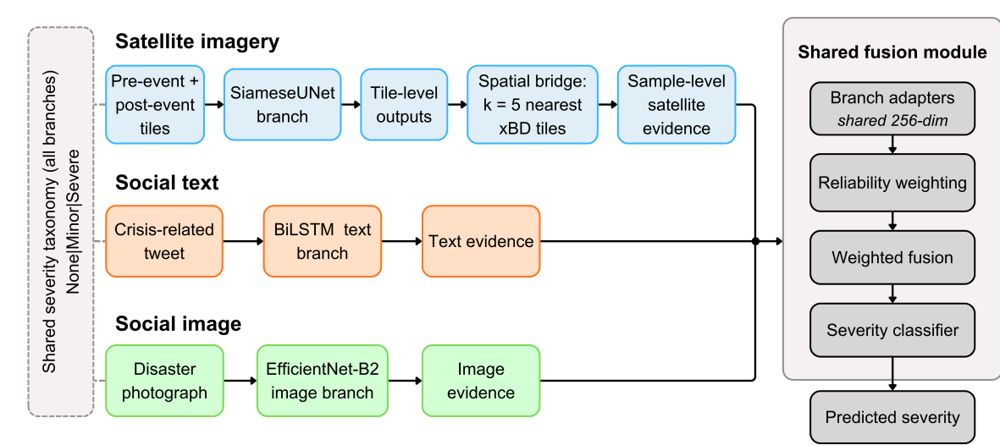
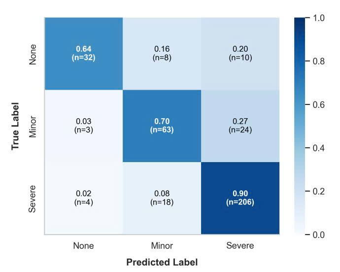

# TriFuse-R: Reliability-Aware Multimodal Fusion for Disaster Damage Assessment

[](TriFuse-R_Paper_3550.pdf)
[](TriFuse-R_Paper_3550.pdf)
[](index.html)
[](https://creativecommons.org/licenses/by/4.0/)

> **Official Project Repository and Webpage for Paper #3550**  
> **Accepted for ORAL Presentation at the 15th International Symposium on Information and Communication Technology (SOICT 2026)**  
> *Published in Springer Lecture Notes in Computer Science (LNCS) / CCIS Proceedings*

---

## 👥 Authors & Affiliations

- **Tu Hoang Thanh**<sup>1</sup> (`Tuhoang.nckh@gmail.com`)
- **Thien Nhan Vo**<sup>2,\*</sup> (`thiennhan.math@gmail.com`) *(Corresponding Author)*
- **Phung Thi Hien**<sup>3</sup> (`hienpt4w@gmail.com`)
- **Ngan Nguyen Xuan Phuong**<sup>4</sup> (`nguyenxuanphuongngan268@gmail.com`)
- **Ngoc Ngan Huynh**<sup>5</sup> (`ngocnganhuynh.work@gmail.com`)
- **Thanh Xuan Truong**<sup>6</sup> (`xunthanh6@gmail.com`)

<sup>1</sup> *National Economics University, Hanoi, Vietnam*  
<sup>2</sup> *HUTECH University, Ho Chi Minh City, Vietnam*  
<sup>3</sup> *Hanoi University, Hanoi, Vietnam*  
<sup>4</sup> *Institute of Intelligent Interactive Technologies, UEH University, Vietnam*  
<sup>5</sup> *Foreign Trade University, Ho Chi Minh City Campus, Vietnam*  
<sup>6</sup> *VNU University of Science, Vietnam National University, Hanoi, Vietnam*

---

## 🌐 Official Project Page

The official project webpage is contained in [`index.html`](index.html). It includes:
- **Full Architecture Deep Dive**: Detailed breakdown of Siamese U-Net, RoBERTa-base, EfficientNet-B2, and temperature-scaled gated evidence fusion.
- **Harmonized Tripartite Benchmark Specification**: Standardized 3-tier severity taxonomy (*None*, *Minor*, *Severe*) harmonized across xBD, HumAID, and CrisisMMD ($N = 368$ aligned gold-standard triplets).
- **Comprehensive Experimental Results & Ablations**: Stratified 5-fold cross-validation, 95% bootstrap confidence intervals, and controlled missing-modality analyses.
- **One-Click BibTeX Citation**: Instant formatted copy for academic references.

### Deploying to GitHub Pages in 2 Steps:
1. This repository is hosted at `https://github.com/thnhan05/soict-TriFuse-R`.
2. On GitHub, navigate to **Settings** &rarr; **Pages** &rarr; Under **Branch**, select `main` and folder `/(root)`, then click **Save**.  
   *Your live project page will be active at: [https://thnhan05.github.io/soict-TriFuse-R/](https://thnhan05.github.io/soict-TriFuse-R/)*

---

## 📖 Abstract

Rapid post-disaster damage assessment is essential for emergency response and relief allocation. While multimodal models combining satellite remote sensing and social sensing offer promising situational awareness, prevailing approaches rely on equal-weight fusion or naive concatenation, ignoring substantial variations in modality reliability due to cloud obscuration, revisit latency, and noisy crowdsourced reports. We propose **TriFuse-R**, an end-to-end reliability-aware trimodal evidence fusion framework that dynamically integrates satellite imagery, humanitarian social text, and ground photographs for damage severity assessment. We establish an aligned multimodal benchmark across Hurricane Harvey and the Mexico Earthquake harmonized into a three-tier taxonomy (*None*, *Minor*, *Severe*) supported by multi-annotator verification (Fleiss' $\kappa = 0.84$). TriFuse-R quantifies modality reliability via predictive confidence and spatial-semantic uncertainty estimation, adaptively aggregating embeddings through calibrated temperature scaling and gated feature modulation. Stratified 5-fold cross-validation across all $N = 368$ samples demonstrates that TriFuse-R achieves **81.8% accuracy** and **76.8% Macro-F1**, significantly outperforming unimodal backbones and equal-weight fusion ($p = 0.008$) with **32.8% lower calibration error**. Controlled missing-modality analyses against re-normalized baselines confirm the operational resilience and fault tolerance of our framework under sensor degradation.

---

## 🏗️ Architecture Overview



### Core Components:
1. **Modality-Specific Feature Encoders**:
   - **Satellite Branch**: Weight-sharing Siamese U-Net ingesting bi-temporal pairs $(\mathbf{I}_{pre}, \mathbf{I}_{post})$ resized to $256 \times 256$.
   - **Text Branch**: Fine-tuned RoBERTa-base processing disaster situational reports (max 128 tokens).
   - **Image Branch**: EfficientNet-B2 extracting granular facade damage and flood inundation features.
2. **Reliability Estimation Module**:
   - **Satellite ($r_{sat}$)**: Derived from mean predictive confidence penalized by spatial prediction entropy $H_{sat}$:
     $$r_{sat} = \bar{c}_{sat}(1 - H_{sat})$$
   - **Text ($r_{txt}$)**: Maximum class probability coupled with semantic predictive entropy $H_{txt}$:
     $$r_{txt} = \max_c P_{txt}(c) \cdot (1 - H_{txt})$$
   - **Image ($r_{img}$)**: Model prediction confidence combined with external crowd-annotator consensus $a_{img}$:
     $$r_{img} = c_{img} \times a_{img}$$
3. **Calibrated Temperature Scaling ($\tau = 0.5$)**:
   $$\hat{r}_m(\tau) = \frac{\exp(r_m / \tau)}{\sum_{j} \exp(r_j / \tau)}$$
4. **Channel Gated Modulation**:
   $$\tilde{\mathbf{f}}_m = \mathbf{f}_m \odot \sigma(\mathbf{W}_{g,m}\mathbf{f}_m + \mathbf{b}_{g,m})$$
   $$\mathbf{f}_{fuse} = \sum_{m} \hat{r}_m(\tau)\tilde{\mathbf{f}}_m$$
5. **Zero-Overhead Test-Time Fault Tolerance**:
   $$\hat{r}_m(\tau) = \frac{\exp(r_m / \tau)}{\sum_{j \in \mathcal{M}_{avail}} \exp(r_j / \tau)}, \quad \forall m \in \mathcal{M}_{avail}$$

---

## 📊 Benchmark & Empirical Results

### Quantitative Comparison on Aligned Benchmark ($N = 368$)

| Method | Accuracy (%) | Macro-F1 (%) | Weighted-F1 (%) | ECE &darr; |
| :--- | :---: | :---: | :---: | :---: |
| Satellite Only (Siamese U-Net) | 69.4 | 62.1 | 68.2 | 0.103 |
| Text Only (BiLSTM) | 68.2 | 63.8 | 67.5 | 0.095 |
| Text Only (RoBERTa) | 73.1 | 68.4 | 72.2 | 0.081 |
| Image Only (EfficientNet-B2) | 77.6 | 72.8 | 76.9 | 0.072 |
| Equal-Weight Fusion (with Gating) | 79.1 | 74.1 | 78.9 | 0.061 |
| Reliability Fusion (Uncalibrated) | 80.4 | 75.2 | 80.1 | 0.055 |
| **TriFuse-R (Ours, $\tau = 0.5$)** | **81.8** | **76.8** | **81.5** | **0.041** |

> *Paired two-tailed bootstrap test demonstrates statistically significant improvement over Equal-Weight Fusion ($p = 0.008 < 0.01$) and 32.8% relative reduction in calibration error (ECE).*

### Confusion Matrix

<p align="center">
  
</p>

---

## 🛡️ Controlled Missing-Modality Stress Test

| Available Sensor Channels | Static Equal-Weight (Macro-F1) | Re-norm Equal-Weight (Macro-F1) | TriFuse-R Ours (Macro-F1) | Gain vs Re-norm |
| :--- | :---: | :---: | :---: | :---: |
| **Complete Trimodal** (All active) | 74.1% | 74.1% | **76.8%** | **+2.7%** |
| **Satellite + Image** (Text missing) | 70.4% | 72.3% | **74.6%** | **+2.3%** |
| **Text + Image** (Satellite missing) | 69.2% | 71.0% | **73.9%** | **+2.9%** |
| **Satellite + Text** (Image missing) | 54.8% | 65.4% | **70.2%** | **+4.8%** |
| **Image Only Fallback** | 58.2% | 67.8% | **72.8%** | **+5.0%** |
| **Text Only Fallback** | 52.4% | 63.8% | **68.4%** | **+4.6%** |
| **Satellite Only Fallback** | 47.9% | 57.5% | **62.1%** | **+4.6%** |

---

## 🗂️ Repository Structure

```text
soict-TriFuse-R/
├── index.html                  # Official Project Webpage (GitHub Pages ready)
├── Paper_Fig_1.png             # Architecture diagram (Figure 1)
├── Paper_Fig_2.png             # Confusion matrix (Figure 2)
├── TriFuse-R_Paper_3550.pdf    # Full camera-ready paper PDF (15 pages, Springer LNCS)
└── README.md                   # Repository overview & setup documentation
```

---

## 📝 Citation

If you find TriFuse-R or our tripartite benchmark useful for your research, please cite our SOICT 2026 paper:

```bibtex
@inproceedings{Thanh2026TriFuseR,
  author    = {Tu Hoang Thanh and Thien Nhan Vo and Phung Thi Hien and Ngan Nguyen Xuan Phuong and Ngoc Ngan Huynh and Thanh Xuan Truong},
  title     = {TriFuse-R: Reliability-Aware Multimodal Fusion for Disaster Damage Assessment},
  booktitle = {Proceedings of the 15th International Symposium on Information and Communication Technology (SOICT 2026)},
  series    = {Lecture Notes in Computer Science (LNCS)},
  publisher = {Springer},
  year      = {2026},
  note      = {Paper ID: 3550, Accepted for ORAL Presentation}
}
```

---

## 📬 Contact & Inquiries

For questions regarding the framework, benchmark dataset, or collaboration, please contact the corresponding author:
- **Thien Nhan Vo**: `thiennhan.math@gmail.com`
